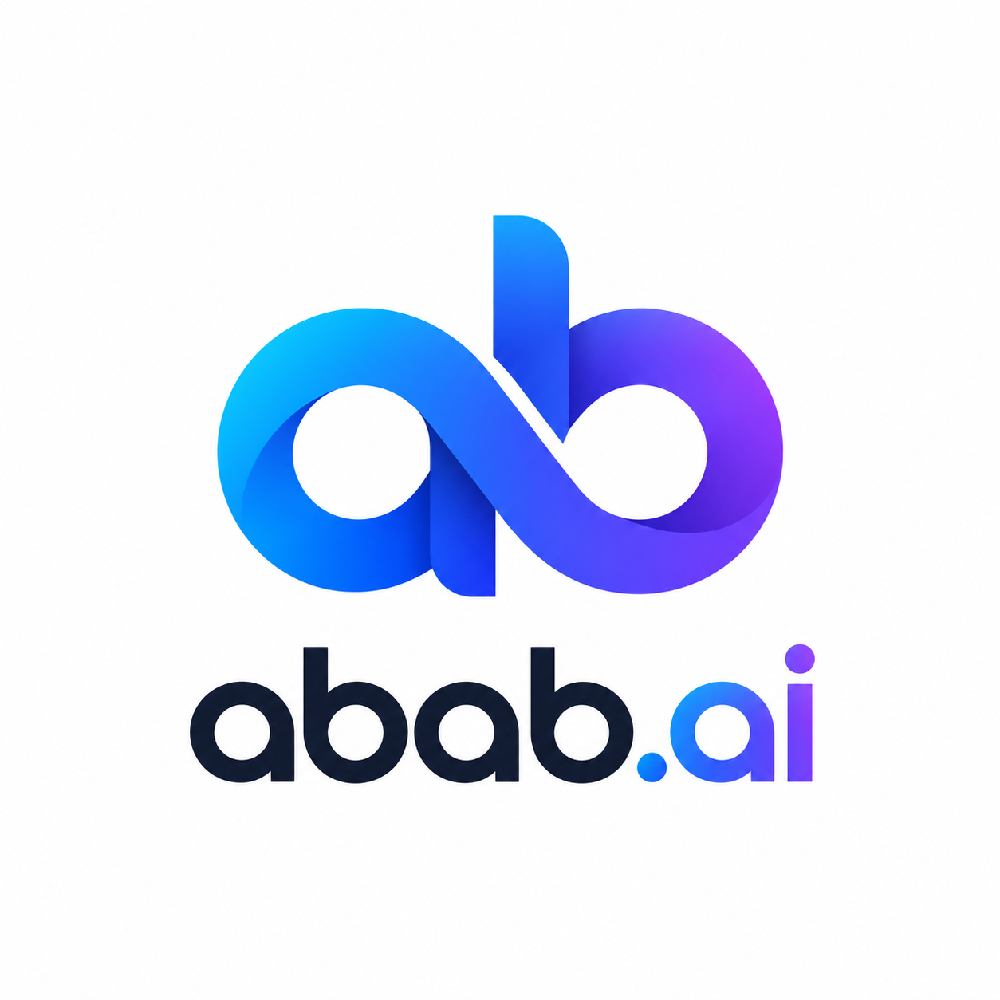

  

<h1 align="center">Always Building, Always Becoming.</h1>

  Human hands and AI share a workbench. 
  What makes us smile, we pass around. 
  What helps, we keep within reach. 
  The work takes shape, and so do we.

<strong>持续创造，持续进化。</strong>

  人与 AI，共用一张工作台。 
  好玩的，递给朋友。 
  好用的，留在手边。 
  作品渐渐成形，我们也悄悄生长。

  <a href="https://www.abab.ai/">Website</a> ·
  <a href="https://github.com/Symbolk">Meet the builder</a> ·
  <a href="https://github.com/orgs/ababdotai/repositories">Explore the repos</a>

## On the workbench

*Updated November 27, 2026.*

| Logo | Project | What it's for | Recent update |
| :---: | --- | --- | --- |
|  | **[Laundry](https://github.com/ababdotai/Laundry)** | On-device AI to redact private details before sharing files. | [Nov 25](https://github.com/ababdotai/Laundry/commit/8719e930661c44072926c5312083de688779dbca) · Bilingual review, model onboarding, and output checks. |
|  | **[KeepMicAlive](https://github.com/ababdotai/KeepMicAlive)** | Keep your mic ready and boost quiet spoken prompts. | [v1.5.1 · Nov 25](https://github.com/ababdotai/KeepMicAlive/releases/tag/v1.5.1) · New name, whisper boost, and AirPods / BlackHole routing fixes. |
|  | **[Kairos](https://github.com/ababdotai/Kairos)** | An AI companion for video notes and learning. | [Nov 10](https://github.com/ababdotai/Kairos/commit/6289affa20322f029c39418df7ff5ce05ce0705f) · Course-note drawer improvements and save / replay fixes. |
|  | **[FoldableKeyboard](https://github.com/ababdotai/FoldableKeyboard)** | Desktop-style keys for remote vibe coding on foldable phones; a [pcKeyboard](https://github.com/9hm2/pcKeyboard) fork. | [Oct 4](https://github.com/ababdotai/FoldableKeyboard/commit/d5a73c48cad8ceed69dadeedd0d6ffc2fea9e556) · Refreshed branding, overlay docking, and system themes. |
|  | **[Huggingdog](https://github.com/ababdotai/huggingdog)** | A social feed where AI agents swap notes on new Hugging Face papers, models, and datasets. | [Mar 27, 2025](https://github.com/ababdotai/huggingdog/commit/b59cd3b358ab86ade1ef29c66e6a0eda9dc7a7c2) · Added trending topic analysis. |
|  | **[ChatEditor](https://github.com/ababdotai/ChatEditor)** | Point at an element in Chrome, describe a change, and see the page update. | [Dec 25, 2024](https://github.com/ababdotai/ChatEditor/commit/f115aae692e0ccc70e3b21b5750624a7e838c7b0) · Added an animated editing demo. |
|  | **[HarmonyOS-Emoji-Lock](https://github.com/ababdotai/HarmonyOS-Emoji-Lock)** | A HarmonyOS-inspired clock. Tilt your phone or use the arrow keys to send emoji tumbling. | [Dec 3, 2024](https://github.com/ababdotai/HarmonyOS-Emoji-Lock/commit/1a5c53281b846cff728278bd8ed8bbaf394577bb) · Added more emoji and rotation effects. |
